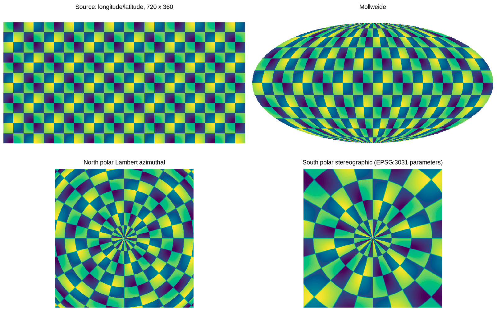

# wxylib/r

R package `wxy`: R bindings for wxylib, via [extendr](https://extendr.github.io).

This is a minimal spike. It binds three functions from
[wxylib/core](https://github.com/wxylib/core), chosen because they are pure
Rust: no I/O, no C libraries, and CRS work through the `proj4rs` backend
that [rwarp](https://github.com/hypertidy/rwarp) uses.



The figure is one R matrix warped three times by `wxy_warp()`; the code is
in [tools/readme-figure.R](tools/readme-figure.R).

```r
library(wxy)

## warp a matrix (row 1 at the north edge) to south polar stereographic
z <- outer(seq(89.5, -89.5), seq(-179.5, 179.5), function(lat, lon) lat)
w <- wxy_warp(z, c(-180, 180, -90, 90), "EPSG:4326",
              dst_extent = c(-5e6, 5e6, -5e6, 5e6), dst_dim = c(200, 200),
              dst_crs = "+proj=stere +lat_0=-90 +lat_ts=-71 +datum=WGS84",
              resample = "bilinear")

## is this coordinate vector regular? (the R2 -> R1 test of the position
## ladder in design doc 02: does it reduce to an origin and a step?)
r <- wxy_regular(seq(-179.5, 179.5, by = 1))
r$regular; r$origin; r$step
#> TRUE -180 1

## geotransform from extent and dimension
wxy_affine(c(0, 10, 0, 5), c(10, 5))
#> [1]  0  1  0  5  0 -1
```

## Building

Needs R and a Rust toolchain (`cargo`, `rustc`). No R package
dependencies.

```sh
R CMD build .
R CMD check --no-manual wxy_*.tar.gz
```

The Rust crate in `src/rust` pins the wxylib crates to a wxylib/core
commit, so the bindings move only when that pin moves.

## What the spike does not do yet

- Windows (`Makevars.win`) and macOS builds.
- CRAN readiness: vendored crates and offline builds (CRAN's Rust policy).
- Reading files (COG, Zarr), PROJ itself, datum grids, C codecs. Those wait
  until the C ABI and Arrow interchange layers exist (design doc 03).
- Bands, nodata in, integer types: `wxy_warp()` takes one double matrix.
- Generated wrappers and docs (`rextendr::document()`, roxygen2); they are
  written by hand here to keep the spike dependency free.

Documentation: **https://wxylib.github.io/docs/**, one place for what works, how-tos,
explainers, the design documents and how to help.

License: MIT OR Apache-2.0.
